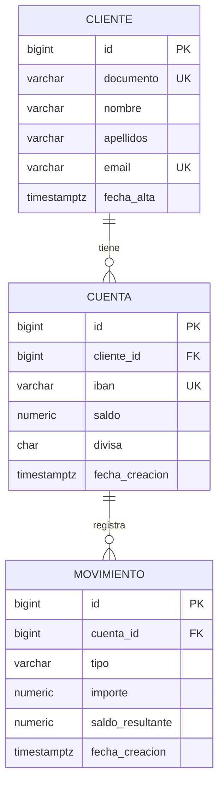

# Banco API

API REST de un banco simplificado: clientes, cuentas con IBAN, ingresos, retiradas, transferencias e historial de movimientos.

Proyecto personal de aprendizaje, construido paso a paso con Java y Spring Boot. Los datos y los IBAN generados son ficticios.

## Tecnologías

- Java 21
- Spring Boot 4 (Web, Data JPA, Validation)
- PostgreSQL 16
- Flyway (migraciones de base de datos)
- Docker y Docker Compose
- JUnit 5 y Testcontainers
- Lombok
- springdoc-openapi (Swagger UI)

## Cómo ejecutarlo

Requisitos: JDK 21 y Docker.

1. Levanta la base de datos:

   ```bash
   docker compose up -d
   ```

   PostgreSQL queda disponible en el puerto `5433` del equipo, con la base `banco` y el usuario `banco` (credenciales solo para desarrollo local).

2. Arranca la aplicación:

   ```bash
   ./mvnw spring-boot:run
   ```

   En Windows: `.\mvnw.cmd spring-boot:run`

3. Flyway crea las tablas en el primer arranque. La API queda en `http://localhost:8080`.

Documentación interactiva (Swagger UI): `http://localhost:8080/swagger-ui/index.html`

## Endpoints

| Método | Ruta | Descripción | Respuesta |
|--------|------|-------------|-----------|
| POST | `/api/clientes` | Crea un cliente | 201 |
| GET | `/api/clientes/{id}` | Consulta un cliente | 200 |
| POST | `/api/cuentas` | Crea una cuenta para un cliente | 201 |
| GET | `/api/cuentas?clienteId={id}` | Lista las cuentas de un cliente | 200 |
| GET | `/api/cuentas/{id}` | Consulta una cuenta y su saldo | 200 |
| POST | `/api/cuentas/{id}/ingresos` | Ingresa dinero en una cuenta | 201 |
| POST | `/api/cuentas/{id}/retiradas` | Retira dinero de una cuenta | 201 |
| GET | `/api/cuentas/{id}/movimientos?page=0&size=20` | Historial paginado de la cuenta, del más reciente al más antiguo | 200 |
| POST | `/api/transferencias` | Transfiere dinero entre dos cuentas | 201 |

### Paginación del historial

El historial se devuelve por páginas:

- `page`: número de página, empezando en 0 (por defecto, 0).
- `size`: elementos por página, entre 1 y 100 (por defecto, 20).

```json
{
  "contenido": [],
  "pagina": 0,
  "tamano": 20,
  "totalElementos": 25,
  "totalPaginas": 2
}
```

`contenido` contiene los movimientos de la página, ordenados por fecha descendente y, en caso de empate, por id.

### Ejemplos de cuerpo

Crear cliente:

```json
{
  "documento": "12345678Z",
  "nombre": "Ana",
  "apellidos": "Lopez",
  "email": "ana@example.com"
}
```

Crear cuenta (el IBAN, el saldo inicial y la divisa los decide el servidor):

```json
{ "clienteId": 1 }
```

Ingreso o retirada:

```json
{ "importe": 100.50 }
```

Transferencia (la cuenta origen se indica por id y la destino por IBAN):

```json
{
  "cuentaOrigenId": 1,
  "ibanDestino": "ES0000000000000000000000",
  "importe": 25.00
}
```

### Errores

Todos los errores usan el formato estándar `ProblemDetail` (RFC 9457), sin exponer trazas internas.

| Código | Cuándo |
|--------|--------|
| 400 | Datos no válidos (incluye el detalle por campo), parámetros de paginación fuera de rango o JSON mal formado |
| 404 | El cliente o la cuenta no existen |
| 409 | Conflicto de datos, por ejemplo un documento duplicado |
| 422 | Regla de negocio incumplida: saldo insuficiente, divisas distintas o transferencia a la misma cuenta |
| 500 | Error inesperado, con mensaje genérico y detalle solo en el log |

## Modelo de datos



## Decisiones técnicas

- **Dinero con `BigDecimal` y `NUMERIC(19,2)`.** Nunca `float` ni `double`, para evitar errores de redondeo. Los importes se validan con un máximo de dos decimales.
- **Restricciones también en la base de datos.** `CHECK (saldo >= 0)`, `CHECK (importe > 0)` y los valores permitidos del tipo de movimiento. Si el código fallara, la base de datos seguiría impidiendo los estados inválidos.
- **El servidor decide lo que el cliente no debe decidir.** El IBAN (con dígitos de control calculados por módulo 97), el saldo inicial y la divisa no se aceptan en la petición.
- **Esquema gestionado con Flyway.** Hibernate solo valida (`ddl-auto=validate`) que las entidades coinciden con las tablas.
- **Movimientos como registro de solo inserción.** Cada operación guarda el saldo resultante, y la API no permite modificar ni borrar movimientos.
- **Una transferencia genera dos movimientos** (`TRANSFERENCIA_ENVIADA` y `TRANSFERENCIA_RECIBIDA`) dentro de una única transacción: o se guardan los dos cambios de saldo y los dos movimientos, o ninguno.
- **Concurrencia con bloqueo pesimista.** Las cuentas se leen con `PESSIMISTIC_WRITE` (`SELECT ... FOR UPDATE`) antes de modificar el saldo, de modo que dos operaciones simultáneas sobre la misma cuenta se ejecutan una detrás de otra.
- **Sin interbloqueos en transferencias.** Las dos cuentas se bloquean siempre en orden creciente de id, sea cual sea el sentido de la transferencia. El id de la cuenta destino se obtiene a partir del IBAN sin cargar la entidad, para no trabajar con un saldo obsoleto.
- **DTOs inmutables con `record`** y validación con Jakarta Validation. Las entidades nunca se exponen directamente.
- **Errores centralizados** con `@RestControllerAdvice` y `ProblemDetail`.
- **Historial paginado con orden estable.** Se ordena por fecha y, en caso de empate, por id, para que dos peticiones consecutivas nunca repitan ni se salten movimientos.
- **Respuesta de página propia.** La API devuelve un `PaginaResponse` en lugar del `Page` de Spring Data, para que el formato JSON no dependa de una clase interna del framework.

## Estructura del proyecto

El código se organiza por funcionalidad y, dentro de cada una, por capas:

```
src/main/java/com/franciscoortega/banco_api
├── cliente      (controller, service, repository, model, dto)
├── cuenta       (controller, service, repository, model, dto)
├── movimiento   (controller, service, repository, model, dto)
└── common       (manejo global de errores, configuración de OpenAPI)
src/main/resources/db/migration   (migraciones de Flyway)
```

## Tests

Los tests de integración usan Testcontainers, que levanta un PostgreSQL real en Docker, así que Docker debe estar en ejecución.

```bash
./mvnw test
```

Los dos tests de concurrencia comprueban las garantías más importantes:

- **Retiradas simultáneas.** Veinte retiradas de 10 € a la vez sobre una cuenta con 100 €: exactamente diez tienen éxito, el saldo final es 0 y se registran diez movimientos.
- **Transferencias cruzadas.** Transferencias simultáneas en ambos sentidos entre dos cuentas: no hay interbloqueos y la suma total de saldos no cambia.

Para ejecutar solo esos tests:

```bash
./mvnw test -Dtest="MovimientoConcurrenciaTest,TransferenciasConcurrenciaTest"
```